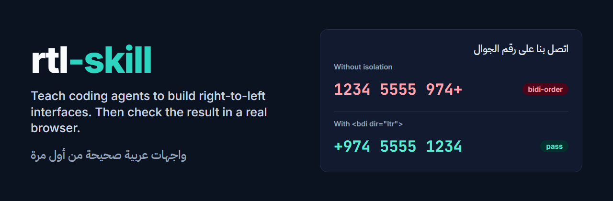
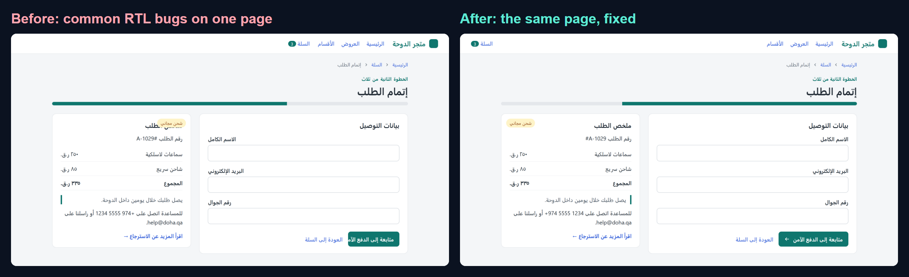
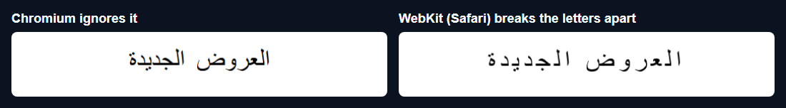
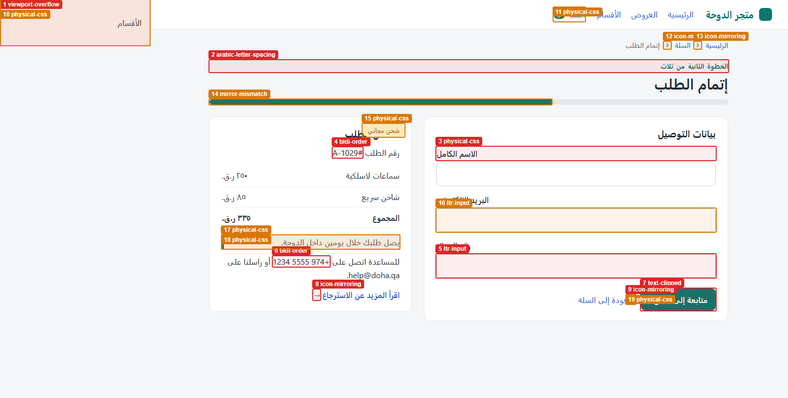
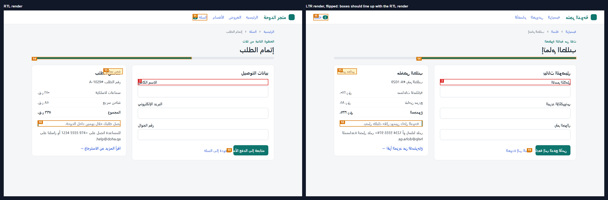

<p align="center">
  
</p>

<p align="center">
  <a href="LICENSE"></a>
  
  
  
  
  
</p>

Coding agents learned to write interfaces from left-to-right code. Ask one for an Arabic page and you get `margin-left`, phone numbers that read `1234 5555 974+`, and "next" arrows that point backwards.

**rtl-skill has two parts.** A skill teaches your agent the rules for Arabic, Persian, Hebrew and Urdu interfaces. A checker opens the finished page in Chromium and measures what actually rendered, down to where each character landed.

## Start here

| You use | Do this | Time |
| --- | --- | --- |
| **Claude Code** | [Install the skill](#claude-code), then ask for any Arabic or RTL UI | 1 minute |
| **Cursor** | [Add the rule](#cursor) to `.cursor/rules` | 1 minute |
| **Codex or AGENTS.md** | [Add the section](#codex-and-other-agentsmd-tools) to your `AGENTS.md` | 1 minute |
| **CI** | [Run `rtl-check`](#use-the-checker) on your preview URL and fail the build on errors | 5 minutes |

## Why

Both pages below use the same text and the same layout. The left one has the bugs this project exists for, all on one page. It was built by hand for this demo, and it passes as "done" if you only glance at it.

<p align="center"></p>

Some of these bugs do not even show up where you test. This is `letter-spacing` on Arabic in two browser engines. A page can look perfect in Chrome and break in Safari:

<p align="center"></p>

## What is in the box

- **One guide, three formats.** `skill-src/guide.md` generates a Claude Code `SKILL.md`, a Cursor `.mdc` rule and an `AGENTS.md` section, so they cannot drift apart. It covers `dir` and `lang`, logical CSS, flex and grid, icon mirroring, bidi isolation, mixed-direction inputs, Arabic fonts and line-height, truncation, `Intl` digits and calendars, charts and progress bars, and Tailwind, React and Vue.
- **Browser behavior checked by running it.** The bidi tables, `Intl` output, input and overflow notes were measured in Chromium, and some in WebKit too. Several first drafts turned out to be wrong: `type="tel"` fields are already LTR, and only `position: absolute` drawers add a scrollbar. Tailwind notes were checked against its source. Notes on other libraries, such as Chart.js and MUI, were not run here.
- **A checker that reads the rendered page.** 10 rules, a text report, JSON, annotated screenshots, an RTL and LTR comparison image, and CI exit codes.
- **Measured results, including the bad ones.** See [Measured results](#measured-results).

## Install the skill

Get the repository once, then install into any project:

```bash
git clone https://github.com/Ifazawezk/rtl-skill.git
cd rtl-skill
npm install
```

### Claude Code

```bash
node dist/rtl-skill.js install claude --dir /path/to/your/project   # writes .claude/skills/rtl/SKILL.md
node dist/rtl-skill.js install claude --global                      # writes ~/.claude/skills/rtl/SKILL.md
```

Or as a plugin, from inside Claude Code:

```text
/plugin marketplace add Ifazawezk/rtl-skill
/plugin install rtl-skill@rtl-skill
```

The skill loads by itself when you work on RTL UI. You can also call it with `/rtl`.

### Cursor

```bash
node dist/rtl-skill.js install cursor --dir /path/to/your/project   # writes .cursor/rules/rtl.mdc
```

The rule attaches automatically to HTML, CSS, JSX, TSX, Vue, Svelte and Astro files. Set `alwaysApply: true` in the file if your whole project is RTL.

### Codex and other AGENTS.md tools

```bash
node dist/rtl-skill.js install codex --dir /path/to/your/project    # adds a section to AGENTS.md
node dist/rtl-skill.js install codex --global                       # adds it to ~/.codex/AGENTS.md
```

Your own notes in `AGENTS.md` are left alone. The section sits between two markers, so running the command again updates it in place. It is about 22 KB, which leaves room inside the 32 KiB that Codex reads by default.

To copy by hand instead, use [`skills/rtl/SKILL.md`](skills/rtl/SKILL.md), [`cursor/rtl.mdc`](cursor/rtl.mdc) or [`codex/AGENTS.md`](codex/AGENTS.md).

## Use the checker

The clone above already built it. Add the browser once:

```bash
npx playwright install chromium
```

Then point it at a URL or a local file:

```bash
node dist/rtl-check.js http://localhost:3000/ar
node dist/rtl-check.js demo/buggy/index.html --out rtl-report
```

Run `npm link` once to get plain `rtl-check` and `rtl-skill` commands everywhere. The rest of this page uses those.

Real output from the demo, shortened:

```text
rtl-check  demo/buggy/index.html
  1280x800, dir=rtl, lang=ar, 309 RTL and 11 LTR letters

   1  error    viewport-overflow     aside.drawer
      This box sticks out 300px past the left edge of the 1280px viewport and gives the page a horizontal scrollbar.

   6  error    bidi-order            p.help
      "+974 5555 1234" renders as "1234 5555 974+". Wrap it in <bdi dir="ltr"> or <span dir="ltr">.

  11  warning  physical-css          a.cart
      margin-left: auto is physical and stays on the same side in both directions. Use margin-inline-start: auto.
      css: .cart { margin-left: auto }
      at: demo/buggy/style.css:27

9 errors, 10 warnings
```

### Options

| Option | What it does |
| --- | --- |
| `--json` | Print the report as JSON |
| `--out <dir>` | Write `report.json`, `annotated.png` and `mirror.png` |
| `--viewport <WxH>` | Viewport size, 1280x800 by default |
| `--mobile` | Same as `--viewport 390x844` |
| `--force-rtl` | Set `dir="rtl"` first, for apps that start LTR |
| `--lang <tag>` | The `lang` to set with `--force-rtl` (default `ar`) |
| `--rules <ids>` | Run only these rules |
| `--skip <ids>` | Skip these rules |
| `--fail-on <level>` | Exit 1 on `error` (default), `warning` or `never` |
| `--wait-for <selector>` | Wait for an element before checking |
| `--wait <ms>` | Extra wait after load |
| `--timeout <ms>` | How long to wait for the page to load (default 30000) |
| `--no-color` | Plain output |

Exit codes: `0` nothing at the `--fail-on` level, `1` findings, `2` usage or runtime error.

### In CI

Run it against a preview build. This is a GitHub Actions step, but any CI works:

```yaml
- run: npm install -g github:Ifazawezk/rtl-skill
- run: npx playwright install --with-deps chromium
- run: npm run build && npm run preview &
- run: rtl-check http://localhost:4173/ar --mobile --out rtl-report
- uses: actions/upload-artifact@v4
  if: failure()
  with:
    name: rtl-report
    path: rtl-report
```

Use `--fail-on warning` for apps that ship both LTR and RTL. See [known limits](#what-it-cannot-see) before you turn that on for an RTL-only site.

### From code

```ts
import { checkPage } from 'rtl-skill';

const report = await checkPage('http://localhost:3000/ar', { viewport: { width: 390, height: 844 } });
console.log(report.summary); // { errors: 2, warnings: 1 }
```

## Rules

| Rule | Default | What it finds |
| --- | --- | --- |
| `dir-attribute` | error | The page has right-to-left text but <html> is not dir="rtl", or RTL paragraphs sit in an LTR block. |
| `lang-attribute` | error | <html> has no lang, or its lang does not match the script on the page (lang="en" on an Arabic page). |
| `physical-css` | warning | A left/right property (margin-left, padding-right, left:, border-left, text-align: left, float) that does not flip with the direction. |
| `mirror-mismatch` | warning | An element sits in a different place than the mirror image of the LTR layout, for example a progress bar that still fills from the left. |
| `bidi-order` | error | A phone number, code snippet, order number or other LTR run renders in the wrong order inside RTL text, like "+974 5555 1234" showing as "1234 5555 974+". |
| `ltr-input` | warning | An email or URL field, or a phone field that is not type="tel", is right to left, so its value reorders while the user types. |
| `icon-mirroring` | error | A directional icon (next, back, chevron, arrow, send) points the LTR way in RTL, or a non-directional icon (play, check, logo) was mirrored. |
| `viewport-overflow` | error | An element sticks out of the viewport and causes a horizontal scrollbar. In RTL this is often an absolutely positioned menu parked at left: -300px. |
| `text-clipped` | error | Text is cut off or spills out of a box with a fixed width or height. Arabic labels are often longer and taller than the English ones the box was sized for. |
| `arabic-letter-spacing` | error | Arabic script text has letter-spacing, which pulls joined letters apart. |

Errors are visible bugs. Warnings need a look: physical CSS does not always show on an RTL-only page, for example. Run `rtl-skill rules` to print this list. Each finding links to the guide section that explains the fix.

## Demo

[`demo/buggy`](demo/buggy) is a Doha checkout page with the bugs in the open. [`demo/fixed`](demo/fixed) is the corrected version. Both run through the checker with `npm run docs`, and the reports are saved next to the images: [buggy](docs/demo/buggy-report.txt), [fixed](docs/demo/fixed-report.txt).

**Buggy page: 9 errors and 10 warnings, across 9 of the 10 rules. Fixed page: 0 and 0.**

<p align="center"></p>

`mirror.png` puts the RTL render next to the flipped LTR render. In a correct page the boxes line up. Here the badge, the cart link and the button do not:

<p align="center"></p>

## Measured results

A checker that scores 100% on its own test pages proves very little. So there are two kinds of numbers here, and the second kind matters more.

The unit is one rule on one page. Full tables are in [`bench/`](bench), and `npm run bench` reproduces the current-code rows.

| Set | Pages | Found | False alarms | Missed | Precision | Recall |
| --- | ---: | ---: | ---: | ---: | ---: | ---: |
| **Blind round 1:** written after freezing the checker, hard on purpose | 40 | 16 | 1 | 9 | **94.1%** | **64.0%** |
| **Blind round 2:** new pages, after fixing what round 1 found | 36 | 19 | 0 | 1 | **100.0%** | **95.0%** |
| Round 1 again, current code (no longer blind) | 40 | 22 | 0 | 3 | 100.0% | 88.0% |
| Regression fixtures (the checker was developed against these) | 100 | 40 | 0 | 0 | 100.0% | 100.0% |

How to read this honestly:

- **The blind rows are first runs**, saved as [`holdout-first-run.md`](bench/holdout-first-run.md) and [`holdout-2-first-run.md`](bench/holdout-2-first-run.md) before any change was made for those pages.
- **Expect recall on your code to fall somewhere between those two rows.** Round 2 has only 20 bug pages, and the same person wrote the pages and the checker. Nobody independent has tested this yet.
- **One round 1 miss was a mistake in the test page**, not in the checker: another rule overrode the bug, so there was nothing to find.
- **The regression row only says nothing has broken.** Those pages shaped the code.

### Real pages

The checker also ran on live pages in October 2026. These pages have no answer key, so **these counts are not accuracy numbers**. They are here to show it runs on real sites, and what the noise looks like.

| Page | Elements | Errors | Warnings | Time |
| --- | ---: | ---: | ---: | ---: |
| Arabic Wikipedia, Doha | 4,103 | 1 | 52 | 11 s |
| Persian Wikipedia, Doha | 3,389 | 6 | 54 | 4 s |
| Hebrew Wikipedia, Doha | 2,795 | 0 | 18 | 2 s |
| BBC Arabic | 1,776 | 0 | 6 | 44 s |

Real pages found real bugs, such as `#coordinates` showing as `coordinates#`. They also exposed false alarms the hand-written fixtures never did, and those fixes are now regression tests: ISO dates read as phone numbers, a carousel peek read as clipped text, and one menu reported 12 times. A fifth site, a large news page, stopped responding during the final run and is left out.

Most of those warnings are `physical-css` on sites that generate a flipped stylesheet. See below.

### What it cannot see

- **Icons with no name.** A bare inline `<svg>` has no class, id or sprite name, so nothing says which way it points. Give it a class such as `icon-chevron-right`.
- **Direction that is only paint.** Gradients, `<canvas>` charts and background images are not boxes. A progress bar drawn with `linear-gradient(to right, ...)` is missed.
- **Numbers split by tags.** In `+974 <b>5555</b> 1234`, each piece is checked on its own and no piece looks like a phone number.
- **Sites that flip their CSS at build time.** With RTLCSS or CSSJanus the RTL stylesheet really does say `float: right`, and that is correct. `physical-css` and `mirror-mismatch` will warn anyway. Use `--skip physical-css,mirror-mismatch`.
- **Anything you must click to see.** It checks the page as loaded, in one viewport. Closed menus and later steps need their own URLs.
- **Other browsers.** Layout rules run in Chromium only. `arabic-letter-spacing` still catches the Safari bug because it reads the CSS, not the pixels.
- **Other machines.** Results were measured on Windows with Chromium 156. `text-clipped` depends on fonts, so a machine with no Arabic fonts can give different results.

## How it works

The interesting checks measure the page rather than read the source:

- **`bidi-order`** finds LTR runs in the text, then asks the browser for the position of every character. If the characters of `+974 5555 1234` do not go left to right on screen, the run is out of order. No regex over your source can see this.
- **`physical-css`** renders the page in RTL, flips it to LTR and measures again. Logical CSS swaps sides and physical CSS stays put, whatever the source looks like. So `[dir="rtl"]` overrides written with `left` and `right` pass, because they do flip. Then it finds the rule that won the cascade and names its file and line. Stylesheets a page may not read, such as anything on a CDN, are fetched separately.
- **`mirror-mismatch`** compares every box with its mirrored LTR position, which catches `transform` and `transform-origin` problems that CSS scanning misses.
- **`icon-mirroring`** reads the meaning from the button label ("التالي", "رجوع"), the artwork from the icon name, and resolves every CSS transform up the tree to see where the icon points on screen.

## Compared with other projects

Other RTL rules for coding agents exist. Those below were found on GitHub in October 2026. The ones with a checker read source code, and that has real advantages: it is fast, it covers code that is not on the current page, and some tools can fix code for you. This project does neither of those last two. It adds the rendered result.

| Project | Rules for agents | Checks your code | Looks at the rendered page |
| --- | --- | --- | --- |
| **rtl-skill** | Claude Code, Cursor, AGENTS.md | No | **Yes: positions, cascade, LTR vs RTL** |
| [rtlify](https://github.com/idanlevi1/rtlify) | Yes, 7 editors | No | No |
| [arabic-ui](https://github.com/JKc66/arabic-ui) | Yes, with Arabic microcopy | No | No |
| [arabic-ready](https://github.com/jubyuhanna-create/arabic-ready) | Yes, also PDF, Word and charts | Yes, static | Renders screenshots for its evals |
| [rtl-ready](https://github.com/miraya-dev/rtl-ready) | Yes | Yes, static, with `--fix` | No |
| [mhamedmohammed92-arch/rtl-skill](https://github.com/mhamedmohammed92-arch/rtl-skill) | Claude Code, Cursor, AGENTS.md | Yes, static | No |
| [samuadda/rtl-skill](https://github.com/samuadda/rtl-skill) | Yes, with evals | Via the skill | No |
| [stylelint-logical-properties](https://github.com/csstools/stylelint-logical-properties) | No | Yes, CSS only | No |
| [RTLCSS](https://github.com/MohammadYounes/rtlcss) | No | Converts CSS to RTL | No |

## Roadmap

- [x] Skill generated for Claude Code, Cursor and AGENTS.md
- [x] 10 checks with file and line for CSS findings
- [x] Annotated screenshots and LTR and RTL comparison
- [x] Blind held-out rounds, published with their misses
- [ ] Publish to npm
- [ ] Find which way an unnamed SVG points from its shape
- [ ] `--browser webkit` to run the checks in Safari's engine
- [ ] Scan a whole site from a sitemap, and diff against a baseline
- [ ] `arabic-font` rule: find text rendered in a fallback font
- [ ] Check after interactions such as open menus and dialogs
- [ ] Independent test pages from other Arabic and Hebrew developers

## FAQ

**Does it work on a page that is not RTL yet?** Yes. Use `--force-rtl --lang ar` to see how an LTR app would break. It sets `dir` for you, so the text stays English, but layout and icon rules still work.

**Why are some findings warnings?** The checker cannot always tell a bug from a choice. A physical `margin-right` might be correct on an RTL-only site. Errors are things you can see are wrong.

**Why not flag `2020-2024` in Arabic text?** It shows as `2024-2020` when read left to right, but Arabic readers read it right to left, so it is correct. Dates, ranges and amounts are left alone on purpose. Phone numbers are not, because they are always written left to right.

**Will it send my pages anywhere?** No. It runs on your machine in a local browser. It fetches only what your page already loads, and it identifies itself with Chromium's normal headless user agent.

**What happens if a site blocks it?** It reports the failure or a note and moves on. It makes no attempt to get around bot checks.

**Does the skill replace testing with real users?** No. Reading a language natively catches things no rule can. This catches the mechanical bugs so reviewers can look at everything else.

## Contributing

New rules, fixtures and false-positive reports are all welcome. A page where the checker is wrong is one of the most useful things you can send. See [CONTRIBUTING.md](CONTRIBUTING.md).

## License

[MIT](LICENSE). Copyright (c) 2026 Mohaned Elhagar.
